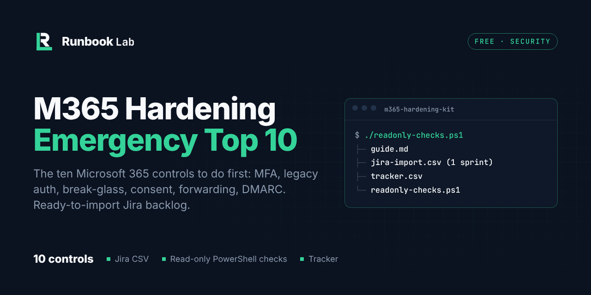

# M365 Hardening Kit: Emergency Top 10 (free)

[](https://runbooklabhq.com/kits/m365-hardening/)

**[Every control on the kit page](https://runbooklabhq.com/kits/m365-hardening/)** · [Microsoft 365 deadline calendar](https://runbooklabhq.com/guides/deadlines/) · [Runbook Lab](https://runbooklabhq.com/)

The ten Microsoft 365 security controls to do first, as a ready-to-run project: guide, Jira backlog, tracker and read-only PowerShell checks.

| File | What it is |
|---|---|
| `m365-hardening-kit-emergency-top-10-guide.md` | Why, steps, check, verify, licence and effort for each control |
| `m365-hardening-kit-emergency-top-10-jira-import.csv` | Jira Cloud import: area epics + 10 tasks with parent links, priority, labels (`runbooklab`, `rl-m365`, the control ID, `sprint-1`, area) and a due date where Microsoft has set one |
| `m365-hardening-kit-emergency-top-10-tracker.csv` | Same backlog for Planner, Azure DevOps, Excel or Linear |
| `m365-hardening-kit-emergency-top-10-project-plan.xlsx` | Excel project plan for teams without Jira: owner, dates, status drop-down, % complete and a progress dashboard by area and sprint |
| `m365-hardening-kit-emergency-top-10-readonly-checks.ps1` | Get-* cmdlets only. Changes nothing. Writes `hardening-check-results.csv` |

Controls: break-glass accounts · MFA for all users · block legacy auth · fewer admins · restrict app consent · audit log · block external forwarding · Standard preset policy · SPF/DKIM/DMARC · SSPR + banned passwords.

## Import into Jira
1. Jira Cloud (as a Jira admin): **Settings > System > External system import > CSV**. This importer links each task to its area epic. The quicker Filters > Search work items > ••• > Import work items from CSV does not set parent links.
2. Choose the CSV and your project, keep UTF-8 and the comma delimiter, and set **Date format** to `yyyy-MM-dd`.
3. Map the columns: Summary → Summary, Issue Type → Issue Type, Issue ID → Issue Id, Parent → Parent, Priority → Priority, Due date → Due date, Labels → Labels, Description → Description (newer Jira sites may call Issue Type and Issue Id "Work type" and "Work item ID").
4. Click Validate, then Begin Import. Find the tasks again with `labels = runbooklab AND labels = rl-m365`.

Works in team-managed and company-managed projects (Epic + Task). Plan sprints with the `sprint-1` label.

## Run the checks
```powershell
Install-Module Microsoft.Graph, ExchangeOnlineManagement -Scope CurrentUser
Connect-MgGraph -Scopes Policy.Read.All,Directory.Read.All,RoleManagement.Read.Directory
Connect-ExchangeOnline
./m365-hardening-kit-emergency-top-10-readonly-checks.ps1
```

## Next: the full kit
**M365 Hardening Kit: Complete** adds 48 controls in Sprints 2-5 (Entra ID, Exchange Online, Teams, SharePoint/OneDrive, Purview), 40 more read-only checks (48 in all), the `m365-hardening-coach` Claude skill that turns your check results into a prioritised plan and a management summary, and **opens the whole plan as Jira tickets with one command** (`Import-RunbookLabPlan.ps1`): it skips tickets that already exist and can record each read-only check result on its ticket. Includes the two late-2026 deadlines: Teams external file sharing default (MC1479514) and SMTP AUTH Basic auth off by default.
→ Kit page: https://runbooklabhq.com/kits/m365-hardening/?utm_source=github&utm_medium=readme&utm_campaign=m365-hardening-kit-free-repo&utm_content=next-kit
→ Buy: https://gumroad.com/l/m365-hardening-kit?utm_source=github&utm_medium=readme&utm_campaign=m365-hardening-kit-free-repo&utm_content=next-kit

More: the free SMTP AUTH checklist https://runbooklabhq.com/guides/exchange-online-smtp-auth-basic-auth-checklist/?utm_source=github&utm_medium=readme&utm_campaign=m365-hardening-kit-free-repo&utm_content=guide and Microsoft 365 security news https://runbooklabhq.com/?utm_source=github&utm_medium=readme&utm_campaign=m365-hardening-kit-free-repo&utm_content=home

MIT licence. Not affiliated with or endorsed by Microsoft. Test changes in Report-only or on a pilot group first.
